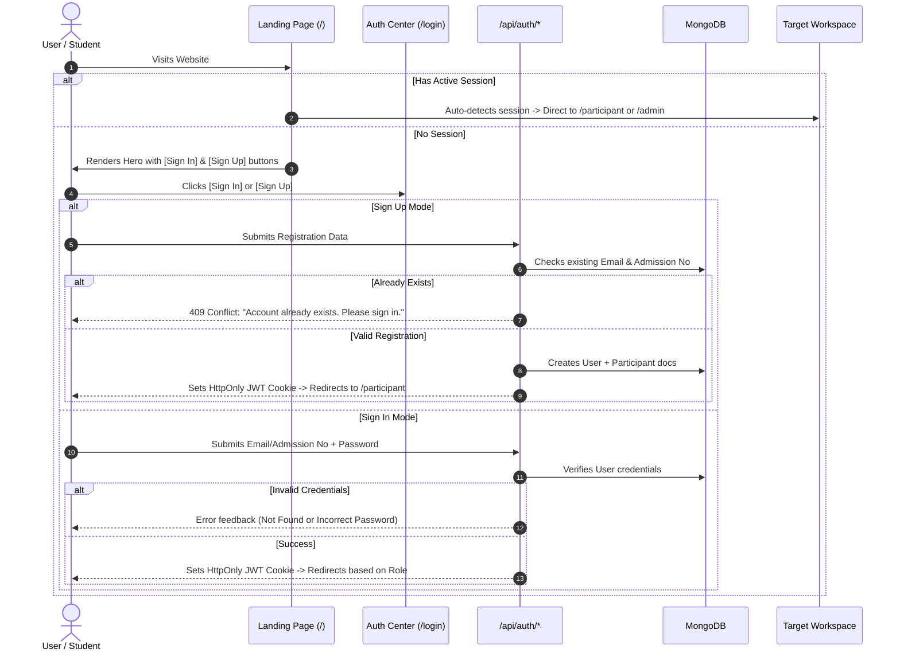

# Procedure 01: User Onboarding and Authentication Flow

> **Applicable Routes**: `/`, `/login`, `/signup`, `/forgot-password`, `/api/auth/*`  
> **Target Personas**: Unauthenticated Visitors, Participants, Mentors, Administrators

---

## 1. Flow Overview

This procedure defines how external visitors enter the platform, authenticate, register, reset credentials, and are directed to their appropriate workspace based on assigned roles and team states.



---

## 2. Landing Page Directives (`/`)

### 2.1 Interface & Directives
1. **Header Navigation**:
   - If user is authenticated: Show **[Open Space]** button directing to `/participant` or `/admin`, and **[Switch Account]** linking to `/login`.
   - If user is unauthenticated: Show **[Sign In]** (secondary) and **[Sign Up]** (primary) buttons.
2. **Hero Action Box**:
   - **Primary Action**: "Enter Workspace" → direct to `/login`.
   - **Secondary Action**: "Create Account" → direct to `/login?mode=signup`.
   - Quick 1-click test credential switchers for local testing (`SUPER_ADMIN`, `PARTICIPANT Lead`, `MENTOR`).

---

## 3. User Registration Flow (`/signup` or `/login?mode=signup`)

### 3.1 Input Requirements
To sign up as a participant, the user must provide:
- **Full Name**: e.g., `Thiganth K`
- **College / Institution**: Defaulted to `Sona College of Technology` (editable)
- **College Email**: Must be a valid email (e.g., `thiganth@sonatech.ac.in`)
- **Phone Number**: Valid 10-digit mobile number
- **Password**: Secure password
- **Confirm Password**: Must match password
- **Terms Agreement**: Checkbox affirming agreement to Build26 participation terms

### 3.2 Submission & Validation Rules
- **Rule 01 — Uniqueness**: Email and Admission Number must be unique.
  - If email or admission number already exists in `User` or `Participant` collection:
    - Return HTTP `409 Conflict`.
    - Display notice: `Account already exists. Please sign in.`
    - Automatically switch user view to the **Sign In** tab with pre-filled email.
- **Rule 02 — Data Persistence**:
  - Automatically create a `User` document with role `PARTICIPANT`.
  - Automatically create a linked `Participant` document with initialized defaults:
    - `skills: ["Web Development"]`
    - `contributionScore: 85`
    - `attendance: "Present"`
    - `status: "ACTIVE"`
    - `avatar: Dicebear SVG seed`
  - Issue JWT cookie `build26_session` (Max-Age: 7 days, HttpOnly, SameSite: Lax).
  - Redirect directly to `/participant`.

---

## 4. User Sign-In Flow (`/login`)

### 4.1 Input Requirements
- **Identifier**: Registered Email Address OR Admission Number
- **Password**: User password

### 4.2 Credential Verification Matrix
1. **Identifier Lookup**:
   - If identifier contains `@`, query `User` and `Participant` by lowercase `email`.
   - If no `@`, query `Participant` by case-insensitive `admissionNumber`.
2. **Account Missing**:
   - Return HTTP `404 Not Found`.
   - Display notice: `No registered account found for "{identifier}". Please check your inputs or sign up to create your account.`
   - Display a direct **[Sign Up Now]** button that transfers their identifier to the sign-up form.
3. **Password Verification**:
   - Compare via `bcrypt.compare`.
   - If mismatch: Return HTTP `401 Unauthorized` with message: `Incorrect password. Please verify and try again.`
4. **Successful Authentication**:
   - Sign token with payload:
     ```typescript
     {
       id: string,
       name: string,
       email: string,
       role: "SUPER_ADMIN" | "ADMIN" | "MENTOR" | "PARTICIPANT",
       participantId?: string,
       teamId?: string,
       mentorId?: string,
       avatar?: string
     }
     ```
   - Set cookie `build26_session`.
   - Execute redirection based on Section 5 below.

---

## 5. Post-Authentication Redirection Decision Matrix

| Role | Has Team Assigned? | Destination Route | UI Environment |
|---|---|---|---|
| `SUPER_ADMIN` | N/A | `/admin` | Admin Command Center with full KPI overview & controls |
| `ADMIN` | N/A | `/admin` | Admin Command Center |
| `MENTOR` | N/A | `/admin/feedback` or `/admin` | Mentor Evaluation & Critique Hub |
| `PARTICIPANT` | **NO** (`team` is null/empty) | `/participant` | **Team Onboarding View** (Full-width, zero sidebar) |
| `PARTICIPANT` | **YES** (`team` assigned) | `/participant` | **Participant Workspace** (Left sidebar active with all tabs) |

---

## 6. Password Reset Flow (`/forgot-password`)

1. User clicks **"Forgot Password?"** link on the `/login` screen.
2. User provides their registered college email.
3. System verifies account existence:
   - If not found: Informs user that no account exists with that address.
   - If found: Issues a secure password reset dispatch or temporary access key.
4. User sets new password and is redirected back to `/login` with success banner.

---

## 7. Sign-Out & Account Switching

1. User clicks **[Sign Out]** in the sidebar profile footer or header menu.
2. Browser issues request to `/api/auth/logout`.
3. Server clears `build26_session` cookie (`Max-Age=0`).
4. User is redirected to `/login` with a clean state.
