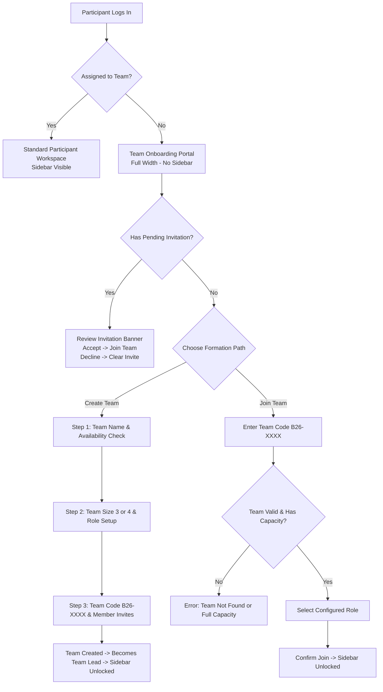

# Procedure 02: Participant Team Formation and Onboarding Flow

> **Applicable Routes**: `/participant`, `/participant/team`, `/api/teams/*`  
> **Target Personas**: Unassigned Participants, Team Leads, Joining Members

---

## 1. Flow Overview

During the initial phase of BUILD26, participants must form multidisciplinary engineering squads of **3 or 4 members**. 

Until a participant belongs to a team:
- The standard **Participant Sidebar is completely removed**.
- The participant is directed to the **Full-Width Team Onboarding View**.
- They can choose one of three paths:
  1. **Accept an existing invitation** (if invited by a squad).
  2. **Create a new team** (assuming the Team Lead role).
  3. **Join an existing team** using a team code.

---

## 2. Unassigned State & Portal Directives

When `Participant.team` is `null`:
1. **Zero Sidebar Rule**: The sidebar navigation must not render. This prevents navigation to pages (e.g. Submissions, Milestones) that depend on a team ID.
2. **Profile & Logout Banner**: The top header displays the participant's name, college, email, and an explicit **[Sign Out]** button so the user is never trapped.
3. **Pending Invitations Banner (Wireframe Section 14)**:
   - If the participant's email matches an invitation with status `INVITED`:
   - Renders a notification box:
     `"You have been invited to join {Team Name} ({Team Code}) as {Role}!"`
   - Actions:
     - **[Accept Invitation]**: Immediately attaches participant to the team and refreshes state.
     - **[Decline]**: Dismisses invitation record.

---

## 3. Path A: Creating a New Team (Team Lead Flow)

When a participant initiates team creation, they progress through a guided 3-step wizard:

### Step 1: Team Name & Availability Check (Wireframe Section 07)
- **Input**: Desired Team Name (e.g. `Team Horizon`, `Pixel Dynamics`).
- **Validation (Rule 03)**:
  - Clicks **[Check Availability]**.
  - Server verifies case-insensitive uniqueness against MongoDB `teams` collection.
  - If exists: Displays red alert `"TEAM NAME ALREADY EXISTS. Please choose another team name."` and blocks progression.
  - If available: Displays green badge `"✓ Team name is available!"` and unlocks the **[Continue to Step 2]** button.

### Step 2: Team Size & Role Allocation (Wireframe Section 08)
- **Team Size Selection (Rule 04)**:
  - Toggle between **3 Members** or **4 Members**.
  - *Constraint*: Team size is permanently locked once the team is created.
- **Team Lead Role (Rule 05)**:
  - The creator is designated as the **Team Lead**.
  - Creator selects their engineering role (e.g., `Full Stack Developer`, `Lead & AI/ML Developer`, `UI/UX & Frontend`).
- **Member Role Slots**:
  - Creator pre-configures the required roles for the remaining seats (e.g., Slot 2: `UI/UX Designer`, Slot 3: `Frontend Developer`, Slot 4: `Backend Developer`).

### Step 3: Code Generation & Member Invitations (Wireframe Section 09)
- **Code Generation**:
  - System automatically generates a unique uppercase team code in the canonical format: `B26-XXXX` (e.g., `B26-X7K9`, `B26-ALPHA`).
  - Team Lead can click **[Copy Code]** to share in team communication channels (WhatsApp, Slack, Discord).
- **Direct Email Invitations (Rule 06 & 07)**:
  - Team Lead enters a peer's registered email and assigns their designated role.
  - System validates that the recipient is already registered in Build26.
  - If not registered: Warns `"Invited participants must already be registered with a Build26 account (Rule 07)."`
  - If registered: Adds invite to pending invitations list.

### Step 4: Completion & Transition
- Team Lead clicks **[Complete Team Creation]**.
- API endpoint `POST /api/teams` creates the team document, links the participant, and sets `isLeader: true`.
- Workspace updates state, **unlocks the Participant Sidebar**, and routes user to the active dashboard.

---

## 4. Path B: Joining an Existing Team (Member Flow)

For students joining a team organized by their squad lead:

### Step 1: Team Code Entry (Wireframe Section 11)
- Participant clicks **[Join Team with Code]**.
- Enters the uppercase team code (e.g., `B26-X7K9`).

### Step 2: Team Verification & Capacity Guard
- Clicks **[Verify Code]**.
- System verifies:
  1. Team exists in database.
  2. Team capacity check: Current members vs. max configured `teamSize`.
     - If team already has max members: Shows error `"Team '{name}' is already at full capacity ({count}/{max} members)."`
  3. Already assigned check: Participant cannot join multiple teams.

### Step 3: Role Selection (Wireframe Section 12)
- Interface loads the team's available/unclaimed roles.
- Participant selects their assigned role (e.g., `Frontend Developer`).
- Role collision check: If a role has already been filled, user is instructed to pick an unassigned role.

### Step 4: Confirmation & Handshake
- Clicks **[Confirm & Join Team]**.
- Server attaches participant to `Team.members`, links `Participant.team`, logs a `PARTICIPANT_JOINED` activity, and unlocks the sidebar.

---

## 5. Team Management & Leadership Transfer

Once formed, teams manage their roster at `/participant/team`:

### 5.1 Team Roster Management
- View all member profiles, assigned roles, contribution scores, and contact details.
- Team Lead can resend or cancel pending email invitations under the `Invitations` tab (`/participant/team?tab=invitations`).

### 5.2 Transfer Leadership Procedure (Wireframe Section 17)
Only the current Team Lead can transfer leadership:
1. Team Lead opens the **[Transfer Leadership]** modal.
2. Selects an active member from the dropdown roster.
3. Enters confirmation phrase or clicks **[Confirm Transfer]**.
4. Server sets `isLeader: false` on current user and `isLeader: true` on the selected member.
5. System logs an `Activity` audit record and refreshes team permissions.
