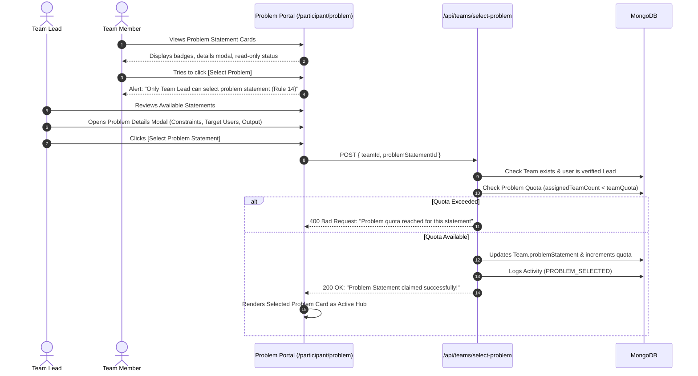

# Procedure 03: Problem Statement Selection Flow

> **Applicable Routes**: `/participant/problem`, `/api/problem-statements`, `/api/teams/select-problem`  
> **Target Personas**: Team Leads, Team Members, Mentors

---

## 1. Flow Overview

On Day 1 of BUILD26, each squad must analyze the available challenges, review problem constraints, and claim an official problem statement.

---

## 2. Problem Statement Catalog & Directives

### 2.1 Catalog Layout (`/participant/problem`)
1. **Header Banner**: Explains the selection guidelines, mentor consultation hours, and selection lock rules.
2. **Category & Difficulty Filters**:
   - Filter by categories: `Campus Tech`, `AI / ML`, `Web3 & Security`, `Sustainability`, `Healthcare / Well-being`.
   - Filter by difficulty: `Beginner`, `Intermediate`, `Advanced`.
3. **Problem Card Metadata**:
   - Title and unique category tag.
   - Assigned teams counter: e.g., `1 / 2 Teams Assigned` (visual quota bar).
   - Core problem summary.
   - Action buttons: **[View Details]** (available to all) and **[Select Statement]** (active for Team Lead).

---

## 3. Detailed Review & Evaluation (Wireframe Section 19)

Clicking **[View Details]** opens the full modal specification:
- **Target Audience / Users**: Who will use this solution (e.g. students, faculty, admissions, placement cell).
- **Current Bottlenecks & Context**: Why current solutions fail.
- **Technical & Operating Constraints**: Required integrations, privacy boundaries, latency requirements.
- **Expected Deliverable Outcome**: Required features for Day 6 final demo.
- **Evaluation Criteria Alignment**: How this statement will be judged during showcase deliberations.

---

## 4. Selection Authority & Rule 14 Enforcement

### Rule 14: Team Lead Privilege
- **Lead Verification**: The system validates leadership against `currentTeam.lead` or `Team.members.find(m => m.isLeader)`.
- **Member Attempt**: If any non-lead member clicks select, an alert immediately informs them:
  `"Only the Team Lead can select the problem statement for your team (Rule 14). Please coordinate with your Team Lead."`

---

## 5. Quota Validation & Selection Handshake

1. Team Lead clicks **[Select This Problem]**.
2. System executes pre-flight checks:
   - **Pre-check 1 — Quota Availability**: Verifies `assignedTeamCount < teamQuota`. If quota is exhausted, button shows `"Quota Reached"` in red and cannot be submitted.
   - **Pre-check 2 — Existing Selection**: If team already claimed a problem, prompts for confirmation before switching.
3. Server executes atomic update:
   - Sets `Team.problemStatement = problemStatementId`.
   - Increments `ProblemStatement.assignedTeamCount`.
   - Creates an audit record in `Activity`:
     `"{Team Name} selected challenge: {Problem Title}"`
4. Interface transitions:
   - The selected problem statement is promoted to the **Selected Problem Card** (Wireframe Section 20) at the top of the screen.
   - Directs the squad to begin **Day 01 Milestone: Solution Ideation & PPT**.
