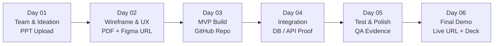

# Procedure 04: Six-Day Sprint and Milestones Execution Flow

> **Applicable Routes**: `/participant/milestones`, `/participant/submissions`, `/api/submissions`, `/api/milestones`  
> **Target Personas**: Team Leads, Team Members, Technical Mentors, Evaluators

---

## 1. Flow Overview

BUILD26 is organized around a strict **6-Day Agile Sprint Progression**. Every day focuses on a distinct engineering milestone with specific objectives, task checklists, and mandatory deliverable submissions.

---

## 2. Daily Milestone Specifications & Submissions

### 2.1 Day 01 — Team + Ideation (Wireframe Section 23)
- **Objective**: Form squad, allocate multidisciplinary responsibilities, lock in problem statement, and articulate initial solution architecture.
- **Mandatory Tasks Checklist**:
  - [x] Create / join team roster.
  - [x] Assign engineering roles (Lead, UI/UX, Frontend, Backend).
  - [x] Select problem statement.
  - [ ] Complete competitive analysis & root-cause problem analysis.
  - [ ] Prepare Solution Ideation slide deck (`.pptx`, `.ppt`, or PDF).
  - [ ] Obtain 100% Team Member Consensus & Sign-Off.
- **Required Submission**:
  - **Deliverable Type**: Slide Presentation (`.pptx` or PDF or Google Slides link).
  - **Upload Feature**: Real file upload (`/api/upload`) or Cloud presentation link with title and abstract.
  - **Team Consensus Gate**: Any team member or Lead stages the deck; all squad members must review and click `[ ✓ Approve PPT ]` (or `[ Request Changes ]`).
  - **Milestone Advancement**: When 100% of squad members approve, the deliverable automatically locks, status transitions to `Submitted`, and advances team milestone gates.

---

### 2.2 Day 02 — Wireframe & User Flow (Wireframe Section 24)
- **Objective**: Convert solution concept into an interactive, user-centric interface and end-to-end journey map.
- **Mandatory Tasks Checklist**:
  - [ ] Define target persona journey maps.
  - [ ] Identify all critical user screens and navigation states.
  - [ ] Construct low-to-mid fidelity UI wireframes.
  - [ ] Review design consistency with team and mentor.
- **Required Submission**:
  - **Deliverable Type**: Wireframe specification (`.pdf` or document) AND optional Figma prototype link.
  - **Input Fields**: Wireframe File URL + Figma URL.
  - **Submission Action**: Click **[ SUBMIT DAY 2 ]**.

---

### 2.3 Day 03 — Build / Repository Initialization (Wireframe Section 25)
- **Objective**: Initialize engineering codebase, establish repo hygiene, configure dependencies, and code core skeleton.
- **Mandatory Tasks Checklist**:
  - [ ] Create team GitHub repository with README, `.gitignore`, and license.
  - [ ] Setup frontend framework and styling design system.
  - [ ] Setup backend services, schema definitions, and server routes.
  - [ ] Commit initial boilerplate and verify local development environment.
- **Required Submission**:
  - **Deliverable Type**: GitHub Repository URL (must be public or accessible to mentors).
  - **Input Field**: `https://github.com/organization/project`.
  - **Submission Action**: Click **[ SUBMIT DAY 3 ]**.

---

### 2.4 Day 04 — Integration & API Handshake (Wireframe Section 26)
- **Objective**: Connect frontend interfaces with backend APIs, database models, and external services (AI models, ledgers, or 3rd party APIs).
- **Mandatory Tasks Checklist**:
  - [ ] Implement data persistence and database seed scripts.
  - [ ] Connect client forms and state management to REST/GraphQL APIs.
  - [ ] Validate end-to-end authentication and session flows.
  - [ ] Verify core business logic handles edge-cases.
- **Required Submission**:
  - **Deliverable Type**: Repository update + Written integration evidence.
  - **Input Fields**: Updated GitHub Repo URL + Integration summary describing verified endpoints, DB models, and test results.
  - **Submission Action**: Click **[ SUBMIT DAY 4 ]**.

---

### 2.5 Day 05 — Test + Polish (Wireframe Section 27)
- **Objective**: Stress-test application, eliminate bugs, optimize responsiveness, refine UI micro-interactions, and ensure zero-crash stability.
- **Mandatory Tasks Checklist**:
  - [ ] Perform cross-browser and mobile responsive testing.
  - [ ] Resolve console errors, network bottlenecks, and UI glitches.
  - [ ] Implement clear loading states, empty states, and toast notifications.
  - [ ] Rehearse product demo script with full team.
- **Required Submission**:
  - **Deliverable Type**: Test and polish audit summary.
  - **Input Field**: Written record of resolved issues, test suite results, and benchmark metrics.
  - **Submission Action**: Click **[ SUBMIT DAY 5 ]**.

---

### 2.6 Day 06 — Final Demo & Product Ship (Wireframe Section 28)
- **Objective**: Deploy live working build, publish final presentation deck, and deliver showcase pitch to jury.
- **Mandatory Tasks Checklist**:
  - [ ] Deploy production web app to hosting provider (Vercel, AWS, Render).
  - [ ] Finalize pitch deck covering Problem, Architecture, Demo, and Impact.
  - [ ] Verify live application health and data persistence under demo conditions.
  - [ ] Submit complete final showcase portfolio.
- **Required Submissions**:
  1. **Live Product URL**: `https://your-product.vercel.app`
  2. **GitHub Repository**: Production source code
  3. **Presentation Deck URL**: Final pitch deck link
  4. **Product Summary Description**: Executive summary for the Hall of Fame Showcase
- **Submission Action**: Click **[ 🚀 SUBMIT FINAL PROJECT ]**.

---

## 3. Submissions Center & Review Status (`/participant/submissions`)

Squads track deliverable evaluation status at `/participant/submissions`:

| Status Badge | Meaning | Directive to Team |
|---|---|---|
| **Pending Review** | Submitted deliverable is in the evaluator queue. | Continue daily sprint work while mentor reviews. |
| **Approved** | Deliverable satisfies rubric criteria. | Milestone locked and marked complete (`✓`). |
| **Changes Requested** | Evaluator noted missing items or issues. | Read evaluator feedback notes, revise deliverable, and re-submit. |

### 50-Point Review Rubric Breakdown
Each milestone is evaluated across 5 key dimensions (10 points each):
1. **Problem Understanding**: Depth of user context and clarity of root problem.
2. **Innovation & Originality**: Distinctiveness compared to existing software.
3. **Technical Approach & Quality**: Code cleanliness, architecture, and technology choice.
4. **Feasibility & Completeness**: Practical viability and implementation progress.
5. **Impact & Scalability**: Potential value to target campus or collegiate audience.
