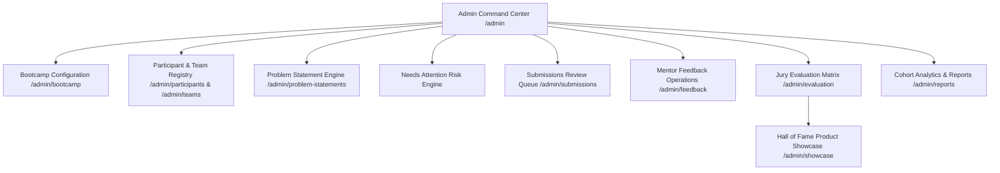

# Procedure 06: Admin Command Center and Governance Flow

> **Applicable Routes**: `/admin`, `/admin/bootcamp`, `/admin/participants`, `/admin/teams`, `/admin/submissions`, `/admin/evaluation`, `/admin/showcase`, `/admin/reports`  
> **Target Personas**: Super Admins, Operations Admins, Technical Mentors, Jury Evaluators

---

## 1. Flow Overview

The **Admin Command Center** operates as the mission control room for the entire bootcamp cohort. It provides organizers with full oversight of all participants, team formation health, daily deliverables, risk alerts, mentor evaluations, and jury scoring.



---

## 2. Admin Command Dashboard (`/admin`)

### 2.1 KPI Monitoring Cards
The top dashboard summarizes vital cohort metrics in real time:
- **Total Registered Participants**: Total students registered in the database.
- **Formed Teams**: Total confirmed squads (3 or 4 members).
- **Unassigned Students**: Participants requiring onboarding assistance.
- **Active Sprint Day & Phase**: Current progression (e.g., Day 3 — MVP Build).
- **Submissions Pending Review**: Deliverables in queue awaiting scoring.
- **Cumulative Engineering Hours**: Total hours logged across all worklogs.
- **Flagged Blockers**: Engineers currently marked as `Blocked`.

### 2.2 Needs Attention Risk Engine
The risk engine scans the database continuously to flag operational anomalies:
1. **Inactive Teams (>12h)**: Squads with no worklogs, submissions, or commits in the last 12 hours.
2. **Missing Submissions**: Teams that missed the cutoff for the previous day's milestone.
3. **Incomplete Rosters**: Teams with fewer than 3 members as the formation deadline approaches.
4. **Pending Mentor Critiques**: Submissions awaiting reviewer assessment >6 hours.

---

## 3. Bootcamp Configuration (`/admin/bootcamp` - Wireframe Section 38)

Admins control overarching sprint rules:
- **Bootcamp Title & Tagline**: Default `BUILD26 — 6-day hands-on product building bootcamp`.
- **Sprint Schedule Dates**: Start Date and End Date.
- **Active Day Selector**: Toggle cohort sprint day (Day 1 through Day 6).
- **Allowed Team Sizes (Rule 04)**: Strict enforcement of 3 or 4 members per squad.
- **Submission Gate Toggle**: Open or close deliverable submissions per milestone.

---

## 4. Participant & Team Administration

### 4.1 Participant Registry (`/admin/participants`)
- Search by student name, email, or admission number.
- Filter by department, year of study, and team assignment status.
- Inspect student contribution score, attendance log, and role in squad.

### 4.2 Teams Command Directory (`/admin/teams`)
- Directory of all 10 squads (e.g., Team Alpha, Nova, Orbit, Pixel, etc.).
- Inspect assigned Problem Statement, mentor, tech stack, and repository link.
- Drill down to individual Team Command pages (`/admin/teams/[teamId]`) to audit worklogs, sprint tasks, and mentor critiques.

---

## 5. Milestone Deliverable Scoring (`/admin/submissions` - Wireframe Section 45)

Admins and Mentors evaluate daily submissions using the **50-Point Standard Rubric**:

| Rubric Dimension | Max Points | Evaluation Focus |
|---|---|---|
| **1. Problem Understanding** | 10 pts | Clarity of pain points, user persona depth, root cause analysis. |
| **2. Innovation & Originality** | 10 pts | Novelty of approach, competitive moat, unique UX. |
| **3. Technical Architecture** | 10 pts | Code hygiene, modularity, framework choices, database design. |
| **4. Feasibility & Quality** | 10 pts | Working prototype execution, stability, zero major defects. |
| **5. Impact & Scalability** | 10 pts | Viability in real collegiate or enterprise environments. |

### Evaluation Verdicts
- **Approved**: Deliverable meets quality threshold; awards points (out of 50).
- **Changes Requested**: Evaluator attaches actionable critique; team is prompted to revise and re-upload.

---

## 6. Official Jury Evaluation Matrix (`/admin/evaluation`)

On Day 6, the official jury conducts final evaluations using the **100% Weighted Matrix**:

```
TOTAL WEIGHTED SCORE = 
    (Problem Understanding × 20%) +
    (Innovation & Differentiation × 20%) +
    (Solution Quality & Feasibility × 20%) +
    (Technical Implementation × 20%) +
    (Presentation & Pitch Delivery × 10%) +
    (Team Collaboration & Discipline × 10%)
```

- Each criterion is rated from 1 to 10.
- Jury enters qualitative notes and recommendations.
- Submitting publishes the final score to the team's record and graduates them to the showcase.

---

## 7. Product Showcase & Hall of Fame (`/admin/showcase`)

Graduated solutions with published scores are featured in the **Product Showcase**:
- **Official Score Badge**: e.g., `★ 92.5 / 100`.
- **Solution Concept & Architecture Overview**: High-level problem statement and solution write-up.
- **Tech Stack Badges**: Next.js, TypeScript, Tailwind, MongoDB, AI/ML, etc.
- **Production Links**:
  - **Live Product URL** (opens production app in new tab).
  - **GitHub Repository** (opens source code).
  - **Pitch Deck** (opens final presentation deck).

---

## 8. Master Reports & Export (`/admin/reports` - Wireframe Section 47)

- **Master Summary Report**: Exportable cohort velocity metrics, attendance logs, and milestone completion percentages.
- **Work Log Audit Table**: Cross-team comparative analysis of hours worked and tasks delivered.
