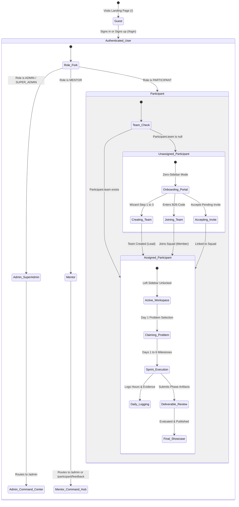

# Procedure 07: System State Transitions and Routing Matrix

> **Applicable System Layers**: Next.js App Router, Middleware/Session Guards, Mongoose Models, Client Route Guards  
> **Target Personas**: Software Engineers, System Architects, Quality Assurance, Platform Operators

---

## 1. System State Machine

Every user in BUILD26 transitions through well-defined lifecycle states:

---

## 2. Route Guard & Access Matrix

| Route | HTTP Methods | Allowed Roles | Guard Condition | Behavior if Guard Fails |
|---|---|---|---|---|
| `/` | `GET` | Public | None | If authenticated, shows quick shortcut to active space. |
| `/login` | `GET`, `POST` | Public / Guest | Unauthenticated | If already authenticated, redirect to role destination. |
| `/signup` | `GET` | Public / Guest | Unauthenticated | Directs to `/login?mode=signup`. |
| `/forgot-password` | `GET`, `POST` | Public / Guest | None | Password reset form. |
| `/participant` | `GET` | `PARTICIPANT` | Valid Session | If no session: redirect to `/login`. If `team` is null: render `TeamOnboardingView`. |
| `/participant/team` | `GET` | `PARTICIPANT` | Valid Session + Team | If `team` is null: contained within `TeamOnboardingView`. |
| `/participant/problem` | `GET` | `PARTICIPANT` | Valid Session + Team | If `team` is null: contained within `TeamOnboardingView`. |
| `/participant/milestones` | `GET` | `PARTICIPANT` | Valid Session + Team | If `team` is null: contained within `TeamOnboardingView`. |
| `/participant/submissions` | `GET` | `PARTICIPANT` | Valid Session + Team | If `team` is null: contained within `TeamOnboardingView`. |
| `/participant/worklogs` | `GET` | `PARTICIPANT` | Valid Session + Team | If `team` is null: contained within `TeamOnboardingView`. |
| `/participant/activity` | `GET` | `PARTICIPANT` | Valid Session + Team | If `team` is null: contained within `TeamOnboardingView`. |
| `/participant/profile` | `GET` | `PARTICIPANT` | Valid Session | If no session: redirect to `/login`. |
| `/admin` | `GET` | `SUPER_ADMIN`, `ADMIN` | Role Authorization | If unauthenticated: redirect to `/login`. If `PARTICIPANT`: redirect to `/participant`. |
| `/admin/bootcamp` | `GET`, `PATCH` | `SUPER_ADMIN`, `ADMIN` | Role Authorization | Non-admins blocked with 403 Forbidden. |
| `/admin/participants` | `GET`, `POST` | `SUPER_ADMIN`, `ADMIN` | Role Authorization | Non-admins blocked. |
| `/admin/teams` | `GET`, `POST` | `SUPER_ADMIN`, `ADMIN` | Role Authorization | Non-admins blocked. |
| `/admin/submissions` | `GET`, `POST` | `SUPER_ADMIN`, `ADMIN`, `MENTOR` | Role Authorization | Non-evaluators blocked. |
| `/admin/evaluation` | `GET`, `POST` | `SUPER_ADMIN`, `ADMIN`, `MENTOR` | Role Authorization | Non-evaluators blocked. |
| `/admin/showcase` | `GET` | Public / Authenticated | None | Public showcase view. |

---

## 3. Edge Cases & Error Recovery Procedures

### Edge Case 01: Expired or Corrupted Session Cookie
- **Condition**: Client sends expired or malformed `build26_session` JWT.
- **Server Response**: `verifyToken` returns `null`.
- **Client Recovery**: Route redirects to `/login` with an informational notice: `"Your session has expired. Please sign in again."`

### Edge Case 02: Unassigned Participant Accessing Deep URLs
- **Condition**: User manually enters `/participant/milestones` in the URL bar before joining or creating a team.
- **System Handling**: `app/participant/layout.tsx` checks `hasTeam`. If `false`, it **intercepts rendering before the page loads** and displays the full-width `TeamOnboardingView`.
- **Outcome**: The user cannot bypass the team formation step.

### Edge Case 03: Non-Lead Attempts Problem Selection (Rule 14)
- **Condition**: A team member who is not the team lead clicks **[Select Problem Statement]**.
- **System Handling**: Client displays an alert banner: `"Only the Team Lead can select the problem statement for your team (Rule 14)."`.
- **API Guard**: `/api/teams/select-problem` validates `team.lead === session.participantId` or `isLeader === true`. Rejects non-leads with HTTP 403.

### Edge Case 04: Team Capacity Exceeded on Code Join
- **Condition**: 5th participant attempts to join a team configured with `teamSize: 4`.
- **API Guard**: Checks `team.members.length >= MAX_TEAM_SIZE`.
- **Response**: HTTP 400 Bad Request with message: `"Team '{name}' is already at full capacity (4/4 members)."`.
- **Client Recovery**: User is returned to code input to enter another team's code or create their own squad.

### Edge Case 05: Duplicate Team Name on Creation (Rule 03)
- **Condition**: User tries to register a team name that matches an existing team (case-insensitive).
- **API Guard**: Pre-checks MongoDB with regex.
- **Response**: HTTP 409 Conflict with message: `"TEAM NAME ALREADY EXISTS. Please choose another team name."`.
- **Client Recovery**: Step 1 blocks advance until an available name is verified.

### Edge Case 06: Inviting Unregistered Student (Rule 07)
- **Condition**: Team Lead tries to invite an email address not registered on Build26.
- **API Guard**: Checks `User` and `Participant` collections.
- **Response**: Rejection with notification: `"Invited participants must already be registered with a Build26 account (Rule 07). Ask them to sign up first."`.

### Edge Case 07: Resubmission After "Changes Requested"
- **Condition**: Milestone deliverable marked as `Changes Requested` by reviewer.
- **System Handling**:
  1. Team workspace displays revision badge on Submissions and Milestones tabs.
  2. Input fields are re-enabled with reviewer notes highlighted.
  3. Team Lead updates deliverable URL/proof and submits again.
  4. Status resets to `Pending Review`.
