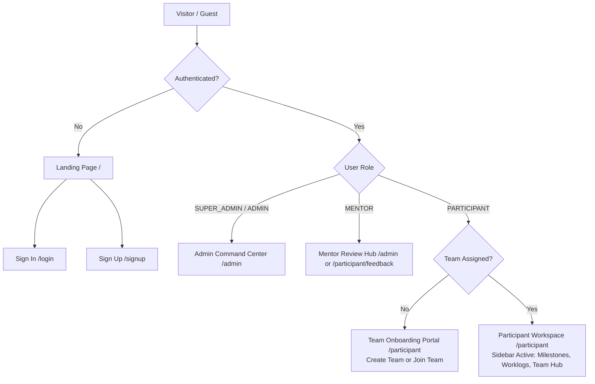

# BUILD26 — User Procedures & Flow Navigation Manual

> **Build • Collaborate • Ship**  
> Comprehensive Operating Procedures and User Flow Directives for the BUILD26 Platform.

---

## 1. Overview & Directory Purpose

This `procedures/` folder serves as the single source of truth for **how all user personas must be directed and guided** across the BUILD26 platform lifecycle.

Whether designing features, onboarding students, directing mentors, running administrative controls, or handling edge-case escalations, these procedures establish:
- **Exact step-by-step paths** each user persona must follow.
- **System gating rules and condition checks** (e.g., authentication, team status, role permissions).
- **Redirection logic and state transitions**.
- **Error recovery and mitigation workflows**.

---

## 2. Document Index & Navigation

| Document | Primary Audience | Key Flows Covered |
|---|---|---|
| [01_USER_ONBOARDING_AND_AUTH_FLOW.md](file:///d:/IMPORTANT_FILES/PROJECT_FILES/build_26/procedures/01_USER_ONBOARDING_AND_AUTH_FLOW.md) | All Users, Guests | Landing Page Hero, Registration, Login, Session Cookies, Role Routing, Password Reset |
| [02_PARTICIPANT_TEAM_FORMATION_FLOW.md](file:///d:/IMPORTANT_FILES/PROJECT_FILES/build_26/procedures/02_PARTICIPANT_TEAM_FORMATION_FLOW.md) | Participants, Team Leads | Unassigned State, 3-Step Team Creation, Code-Based Joining, Invitation Acceptance, Leadership Transfer |
| [03_PROBLEM_STATEMENT_SELECTION_FLOW.md](file:///d:/IMPORTANT_FILES/PROJECT_FILES/build_26/procedures/03_PROBLEM_STATEMENT_SELECTION_FLOW.md) | Team Leads, Members | Problem Statement Directory, Filtering, Quota Check, Selection Handshake, Lock & Confirmation |
| [04_SIX_DAY_SPRINT_AND_MILESTONES_FLOW.md](file:///d:/IMPORTANT_FILES/PROJECT_FILES/build_26/procedures/04_SIX_DAY_SPRINT_AND_MILESTONES_FLOW.md) | Participants, Leads, Mentors | Day 01 (Idea PPT) to Day 06 (Live Demo), Submission Gates, Checklists, Deliverable Artifacts |
| [05_DAILY_WORK_LOGGING_AND_ACTIVITY_FLOW.md](file:///d:/IMPORTANT_FILES/PROJECT_FILES/build_26/procedures/05_DAILY_WORK_LOGGING_AND_ACTIVITY_FLOW.md) | Participants | Daily Work Log Entry, Blocker Logging, Proof URL, Attendance Sync, Team Pulse Stream |
| [06_ADMIN_COMMAND_CENTER_AND_GOVERNANCE_FLOW.md](file:///d:/IMPORTANT_FILES/PROJECT_FILES/build_26/procedures/06_ADMIN_COMMAND_CENTER_AND_GOVERNANCE_FLOW.md) | Super Admins, Ops Admins, Jury | Bootcamp Config, Needs Attention Engine, 50-pt Rubric Scoring, 100% Jury Matrix, Showcase |
| [07_SYSTEM_STATE_TRANSITIONS_AND_ROUTING_MATRIX.md](file:///d:/IMPORTANT_FILES/PROJECT_FILES/build_26/procedures/07_SYSTEM_STATE_TRANSITIONS_AND_ROUTING_MATRIX.md) | Developers, Architects, Admins | Complete Route Guards, State Machine Diagrams, Error Responses, Fallback Matrix |

---

## 3. High-Level User Persona Hierarchy

---

## 4. Master Principles for User Direction

1. **Clear Gatekeeper Directives**: A participant without a team must never see team workspace tabs that require a team context. They are confined to the full-width Onboarding Portal until a team is created or joined.
2. **Deterministic Role Privileges**: Actions such as selecting a problem statement, submitting milestone deliverables, or transferring leadership are strictly reserved for the Team Lead. Other team members receive read-only guidance with actionable status notifications.
3. **Daily Cadence Guidance**: Every day of the 6-day sprint requires:
   - Milestone checklist completion and required artifact submission.
   - Individual work logging with active hours and proof of progress.
4. **Immediate Error Recovery**: When a team code is invalid, a team is full, or an email already exists, the interface provides clear diagnostic messages and directs the user to the exact resolution step.
